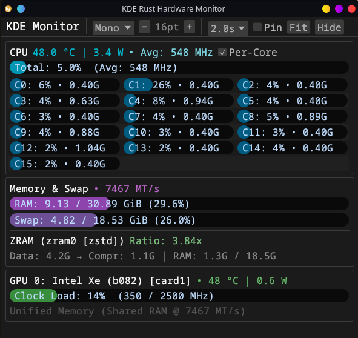

# kde-rust-mon

This was created by Gemini Argon as a test.

A low-overhead, zero-allocation Linux hardware resource monitor built in Rust for KDE Plasma (and compatible with GNOME via AppIndicator). It runs as a native `StatusNotifierItem` system tray icon with an on-demand `eframe`/`egui` dashboard window that frees all GPU/GUI memory when closed.

## Features


- **Zero-Allocation Polling:** Uses persistent open file descriptors with `seek(0)` on `/proc/stat`, `/proc/meminfo`, `/sys/class/drm`, `/sys/devices/system/cpu`, and `/sys/block/zram*`—no subprocess spawning (`nvidia-smi`, `sensors`, `dmidecode`, `zramctl`).
- **CPU Metrics:** Total utilization, package temperature (`coretemp` / `k10temp` / `zenpower`), average clock speed, and expandable per-core utilization and frequencies.
- **Multi-GPU Support (NVIDIA, AMD, Intel `xe` & `i915`):**
  - Clock-based utilization (`act_freq / max_freq`), current/max GPU clock speeds, temperature, and wattage.
  - Dedicated VRAM usage and clock speed for discrete GPUs; unified memory transfer rate (`MT/s`) for integrated GPUs (including Intel Arc `xe`).
- **Memory, Swap & ZRAM:** RAM usage (`MemTotal - MemAvailable`), configured DIMM speed (`MT/s`), swap usage, and per-device ZRAM compression stats (`algorithm`, `DATA`, `COMPR`, `TOTAL` physical RAM, `DISKSIZE`, and live compression ratio).
- **KDE Tray & Dashboard Window:**
  - Live 3-bar tray gauge (**Cyan:** CPU, **Purple:** RAM, **Green:** Max GPU) with rich HTML hover tooltips.
  - Toggleable window with **Pin on Top**, **Fit** (tight auto-sizing to content), resizable borders, live **Font Family** (`Sans`/`Mono`/`Serif`) and **Font Size** (`9pt`–`24pt`) controls, and configurable refresh intervals (`0.5s`, `1.0s`, `1.5s`, `2.0s`).
  - Settings persist automatically to `~/.config/kde-rust-mon.conf`.

---

## System Permission Changes (Optional but Recommended)

The monitor runs completely unprivileged as your normal user. However, Linux restricts two hardware sysfs paths to `root` by default (`0400`). Adding two `udev` rules allows `kde-rust-mon` to read **Intel iGPU/SoC wattage** and **SMBIOS RAM speed (`MT/s`)** without running as root.

### 1. Intel RAPL Power Counters (for Intel iGPU / Package Wattage)
Linux restricts `/sys/class/powercap/intel-rapl:*/energy_uj` to root due to CVE-2020-8694. Grant read access across reboots:

```bash
sudo tee /etc/udev/rules.d/99-intel-rapl-read.rules << 'EOF'
SUBSYSTEM=="powercap", KERNEL=="intel-rapl:*", RUN+="/bin/chmod -R a+r /sys/class/powercap/%k"
EOF
sudo chmod -R a+r /sys/class/powercap/intel-rapl*

```

### 2. SMBIOS DMI Memory Tables (for RAM Speed in `MT/s`)

Linux restricts `/sys/firmware/dmi/entries/17-*/raw` to root by default. Grant read access so the monitor can read your configured DDR/LPDDR transfer rate:

```bash
sudo tee /etc/udev/rules.d/99-dmi-mem-read.rules << 'EOF'
SUBSYSTEM=="dmi", KERNEL=="id", RUN+="/bin/chmod a+r /sys/firmware/dmi/entries/17-*/raw"
EOF
sudo chmod a+r /sys/firmware/dmi/entries/17-*/raw

```

Reload `udev` rules after creating both files:

```bash
sudo udevadm control --reload-rules

```

*(Note: NVIDIA NVML metrics, AMD DRM/hwmon sensors, Intel `xe`/`i915` frequencies, CPU stats, and ZRAM metrics are already readable by unprivileged users out of the box.)*

---

## Build & Installation

### 1. Install Build Dependencies

* **Ubuntu / Kubuntu / Debian:**
```bash
sudo apt install libdbus-1-dev pkg-config build-essential

```


* **Fedora:**
```bash
sudo dnf install dbus-devel pkgconf-pkg-config gcc

```


* **Arch Linux:**
```bash
sudo pacman -S dbus pkgconf base-devel

```


### 2. Compile & Install

```bash
cargo build --release
sudo cp target/release/kde-rust-mon /usr/local/bin/

```

---

## Usage

* **Launch with Dashboard Window Open:**
```bash
kde-rust-mon

```


* **Launch Silently in System Tray:**
```bash
kde-rust-mon --tray

```


* **KDE Plasma Autostart:**
Create `~/.config/autostart/kde-rust-mon.desktop`:
```ini
[Desktop Entry]
Type=Application
Name=KDE Rust Hardware Monitor
Exec=/usr/local/bin/kde-rust-mon --tray
Icon=utilities-system-monitor
Terminal=false
X-KDE-AutostartPhase=2

```


### Desktop Notes

* **KDE Plasma:** Left-clicking the tray icon toggles the stats window; hovering displays the full multi-GPU/ZRAM tooltip; right-clicking adjusts the polling interval or quits.
* **GNOME:** Requires the **AppIndicator and KStatusNotifierItem Support** extension (`gnome-shell-extension-appindicator`). Left-clicking the tray icon opens the menu containing **Toggle Stats Window**.
